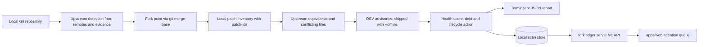

# ForkLedger

ForkLedger is a Go command line tool for engineering and platform teams that run patched copies of open source: it works out which upstream a fork came from, which local patches are still needed, and which upstream fixes the fork is missing.

It discovers repositories that were copied, forked, vendored, patched, or otherwise diverged from an upstream project. It tracks the private patches that remain, finds upstream changes that never reached the fork, and helps a team decide whether to retain, upstream, rebase, replace, or retire the work.

It is not another Git dashboard. It is not another vulnerability scanner. It is not an AI wrapper. Git remains the source of truth for history. Security databases remain the source of truth for advisory metadata. ForkLedger interprets those facts in the context of a modified tree.

## How it works



Everything runs through `git` subprocesses on your machine. ForkLedger never runs hooks or scripts from the repository it analyses.

## First run

```
forkledger analyze .
```

This is a real run against a clone of `mattn/go-isatty`, rolled back five commits, with `origin` renamed to `upstream` and one local patch on top (offline mode):

```
ForkLedger Analysis

Detected upstream                github.com/mattn/go-isatty
Baseline                         0.0.20
Current upstream                 v0.0.24
Fork point                       433c12b4c9fa
Ahead / behind                   1 / 5

Local modifications              1 patch
Changed lines                    1
Likely upstream equivalents      0 patches
Potentially obsolete             0 patches
Potential conflicts              1 patch

Security
  Relevant upstream fixes missing 0
  Findings needing investigation 0

Suggested lifecycle action       RETAIN
Confidence                       LOW (35). This is an estimate from evidence, not a guarantee.

Fork health 89
  upstream drift                 -1. 5 commits behind upstream
  conflicting patches            -2. 1 patches touch files also changed upstream
  ownership                      -8. no owner is recorded in forkledger.yaml
```

Confidence is low here because there is only one tiny patch and no owner in `forkledger.yaml`. Exact numbers depend on evidence. ForkLedger will not invent confidence.

To reproduce it (re-run on 1 November 2026 with identical results; the exit code is 1 because findings are present):

```
git clone https://github.com/mattn/go-isatty isatty && cd isatty
git reset --hard HEAD~5
git remote rename origin upstream
echo "// local patch" >> isatty_others.go
git commit -am "local patch"
forkledger analyze --offline .
```

The upstream tag shown as "Current upstream" will move as go-isatty releases new versions.

## Why this matters

Most companies run patched copies of open source somewhere: a vendored library, an old fork of an SDK, an internal build of a database. Those patches quietly go stale, upstream security fixes never land, and nobody remembers why the fork exists. ForkLedger turns that into a list of facts a team can act on: what was changed, what upstream already fixed, what will conflict, and who owns it.

## What v0.1 does

- Inspects a Git repository and its remotes
- Detects upstream candidates with evidence and confidence
- Estimates the fork point from `git merge-base`
- Inventories local patches, including Git patch-ids
- Finds likely upstream equivalents
- Flags files changed on both sides of the fork
- Associates OSV advisories with the fork when network access is allowed
- Writes a machine readable report and a terminal report
- Exits with codes that CI can act on

`forkledger serve` exposes a local HTTP API for stored scans. The web app at `apps/web` reads `/v1/attention` when that API is running.

`--fetch` updates remote-tracking refs only. It does not checkout the working tree.

`forkledger upgrade` replays local patches with cherry-pick inside an isolated worktree. Build and test commands run there only if `FORKLEDGER_ALLOW_BUILD=1` is set.

## Tests and checks

Run on 1 November 2026 with Go 1.27 and Node 20:

| Check | Result |
| --- | --- |
| `go test ./...` | 12 packages pass (9 packages have no test files) |
| `go vet ./...` | clean |
| `go build -o bin/forkledger ./cmd/forkledger` | builds, `forkledger version` prints `0.1.0` |
| `forkledger analyze --offline .` on the go-isatty example | same output as above |
| `forkledger analyze --json --offline .` | valid JSON report |
| `forkledger doctor` | git and repository ok |
| `forkledger serve :8099`, then `GET /v1/attention` | returns the stored scan |
| `npm ci && npm run build` in `apps/web` | builds (routes `/` and `/repository`) |
| GitHub Actions (`go test`, `go vet`) | passing on `main` |

Not verified: GitHub metadata and OSV lookups (all runs were offline), `forkledger upgrade`, `discover`, `sbom`, `vex`, the GitHub App webhook and `action.yml` in another repository.

## Install

Go 1.22 or newer and Git 2.38 or newer are required.

```
git clone https://github.com/TEHILLA-O/fork_ledger.git forkledger
cd forkledger
go build -o bin/forkledger ./cmd/forkledger
go test ./...
```

Or install straight from the module path:

```
go install github.com/TEHILLA-O/fork_ledger/cmd/forkledger@latest
```

## Commands

```
forkledger analyze [path]
forkledger upstream
forkledger patches
forkledger security
forkledger upgrade <ref>
forkledger report [file]
forkledger policy check
forkledger explain
forkledger doctor
forkledger serve [:8080]
forkledger ingest [report.json]
forkledger discover <org>
forkledger sbom
forkledger vex
forkledger version
```

Flags must go before the path. `forkledger analyze --json .` prints JSON, but `forkledger analyze . --json` silently ignores `--json` (standard Go flag parsing, see [FAILURES.md](FAILURES.md)). Useful flags:

```
--json
--quiet
--verbose
--debug
--config PATH
--output PATH
--offline
--path PATH
```

### Exit codes

| Code | Meaning |
| --- | --- |
| 0 | Completed without blocking findings |
| 1 | Findings present |
| 2 | Usage error |
| 3 | Not a Git repository |
| 4 | Analysis failed |

Full command reference: [docs/cli.md](docs/cli.md).

## Configuration

Place `forkledger.yaml` at the repository root. See [examples/forkledger.yaml](examples/forkledger.yaml) and [docs/configuration.md](docs/configuration.md). Recording an owner there removes the ownership penalty from the health score. `forkledger doctor` reports whether a config file and a GitHub token were found; the token is optional and only used for GitHub metadata.

Build and test commands are never inferred from repository scripts. They must be listed explicitly. ForkLedger will not execute hooks or helper programs from the repository under analysis.

## Privacy

Default analysis is local. Repository contents stay on the machine unless you opt into a network query.

`--offline` disables GitHub metadata and OSV lookups.

When network is enabled, ForkLedger may send:

- Public GitHub owner and repository names, to read fork parent metadata
- Commit hashes and package coordinates, to query OSV

It does not upload source trees. See [docs/privacy.md](docs/privacy.md) and [docs/security-model.md](docs/security-model.md).

## Project structure

```
fork_ledger/
├── cmd/forkledger/      CLI entry point
├── internal/
│   ├── scanner/         end to end analysis
│   ├── git/             git subprocess plumbing
│   ├── upstream/        upstream detection and evidence
│   ├── patches/         patch inventory and patch-ids
│   ├── fingerprint/     MinHash, SimHash and Go AST comparison
│   ├── security/        OSV and GHSA lookups, SBOM and VEX output
│   ├── upgrade/         isolated patch replay
│   ├── isolate/         worktree sandboxing
│   ├── policy/          policy checks
│   ├── api/, store/     local scan API and file store
│   ├── githubapp/       GitHub App webhook handler
│   └── ...              config, report, discover, logging, version
├── apps/web/            Next.js attention queue
├── packages/contracts/  JSON schema for the analysis report
├── examples/            sample forkledger.yaml
├── docs/                architecture, CLI, config, evidence, privacy, security model
├── action.yml           GitHub Action wrapper
└── Makefile             build, test, vet, fixtures, web
```

Deeper reading: [docs/architecture.md](docs/architecture.md), [docs/evidence.md](docs/evidence.md), [docs/git-analysis.md](docs/git-analysis.md), [docs/github-app.md](docs/github-app.md).

## Limitations and known issues

- Flags placed after the path are ignored without an error.
- Fuzzy patch equivalence (MinHash, SimHash, AST) can produce false matches. These are reported as likely or possible, never acted on automatically.
- Upstream detection depends on remotes. A vendored copy with no remote needs the upstream pinned in `forkledger.yaml`.
- `apps/api`, `services/analyzer` and `packages/shared` only contain READMEs; the API lives in the Go binary for now.
- No users, adoption figures or performance benchmarks exist yet. Scan time on the small example above was about 60 ms, which says nothing about large monorepos (not measured yet).

## Status

This is v0.1. Local analysis, isolated upgrade replay, the local scan API and the file store work today. The web control plane in `apps/web` reads from the local API and is early. The GitHub App webhook handler and organisation discovery exist in code but are not production tested yet. Known gaps are written down in [FAILURES.md](FAILURES.md).

## Stack

Go 1.22 for the CLI and analysis engine, Git plumbing through `git` subprocesses, a JSON file store for scans (with a relational schema drafted for the future control plane), OSV and GHSA for advisories, CycloneDX or SPDX SBOM and OpenVEX output, and a small Next.js app for the attention queue. CI runs `go test` and `go vet` on every push, and `action.yml` lets other repositories run ForkLedger in a pull request.

## License

[Apache License 2.0](LICENSE). More of my work is at [cv.omnitest.dev](https://cv.omnitest.dev/).
